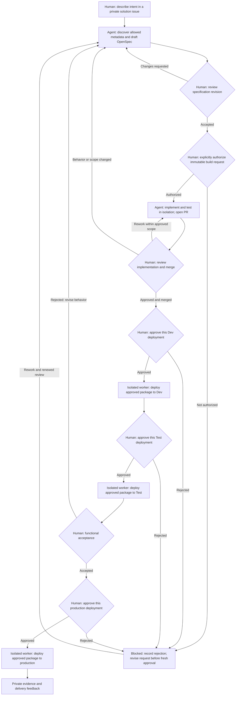

# Fabric-Delivery-OS

Specification-first, human-governed delivery for Microsoft Fabric.

The intended workflow takes a private solution issue through discovery,
specification, implementation, and staged delivery. Agents do bounded work;
humans decide what may be built, merged, and deployed.

## What exists today

**There is no complete runnable platform or released installer.** Cloning this
repository does not start agents, configure approvals, or provision resources.

| Area | Actual status |
| --- | --- |
| Framework on `main` | Primarily specifications. The [OpenSpec proposal](openspec/changes/establish-fabric-delivery-os/proposal.md), contracts, and checklist are committed, but are not blanket implementation authorization. |
| Authorization core | [Open PR #3](https://github.com/Remc0000/Fabric-Delivery-OS/pull/3), not merged: a bounded local SQLite, single-authority library for immutable manifests and externally verified, single-use grants. It does not authenticate human reviews, verify federation, provide a distributed backend, or run the platform. |
| Native GitHub gate proof | Separate public control smoke tests demonstrated human approval, human rejection, and refusal of a representative Actions-bot token. These are bounded gate tests, not production authorization or worker/cloud integration. |
| Azure runtime and onboarding | Initial private context/planning work, not a released cloud installer or completed integration. |

The [bot-refusal proof run](https://github.com/Remc0000/Fabric-Delivery-OS-Control/actions/runs/44172361707)
used workflow revision `3c8ab11dfb2660dd451d701e11458527c67bc868`.
The token could read the run but was not an eligible reviewer; its review attempt
returned HTTP 422 with no reviewable request. The native gate remained waiting,
with no runner or steps started and no review history. The run was cancelled
without approval, the workflow disabled, and the temporary environment removed.
This tests that Actions token only, not every future GitHub App identity. The
author's control repository is proof evidence, not a shared service for adopters.
The [control evidence/removal PR #7](https://github.com/Remc0000/Fabric-Delivery-OS-Control/pull/7)
is open for human review; it has not been merged.

## Repository and execution boundaries

| Repository | Visibility | Responsibility |
| --- | --- | --- |
| Framework (this repository) | Public | Reusable specifications and proposed runtime/module contracts; future versioned framework releases |
| Installation control (adopter-owned) | Public | Trusted native GitHub approval gates for that installation |
| Solution (adopter-owned) | Private | Issues, solution specifications, implementation, configuration, and detailed delivery evidence |

GitHub Free supports native required-reviewer gates in the public control
repository. **Protected jobs must run in that control repository itself.**
Calling a public reusable workflow from a private solution workflow does not
transfer the protection. Each adopter must verify reviewer eligibility,
trusted workflow/ref restrictions, and prevention of administrative bypass
before activation.

Public workflow definitions, run existence, timing, stage labels, and actor
information exposed by GitHub can be visible. Public control must receive only
opaque request references and allowlisted status, never private mappings,
manifests, code, prompts, records, model output, or raw logs. If that operational
metadata disclosure is unacceptable, this GitHub Free topology is incompatible;
do not activate it or weaken its gates.

In the planned architecture, autonomous model work runs on **private,
adopter-owned Azure compute using approved Foundry model deployments**, initially
with Python and Microsoft Agent Framework. The minimal trusted public dispatcher
is not where models or private code execute. Fixed, deterministic, isolated
deployment workers use separate environment identities; they do not let an agent
or arbitrary generated script wield deployment credentials. Azure hosting alone
does not guarantee that downstream tools/model routes meet a tenant or regional
data policy.

## Human and agent process

This is the **target lifecycle**, not an already wired end-to-end workflow.

- **Specification review/merge is not build permission.** A human decision must
  explicitly authorize the corresponding build request; acceptance or structural
  validation alone cannot start implementation.
- **Implementation review/merge is another human decision.** Agents may propose
  changes and review findings, but never approve or merge their own work.
- **Dev, Test, and production each need independent explicit approval for every
  deployment attempt.** Functional acceptance is not production permission.
  Permitted data loads, scheduling, destructive operations, and recovery must be
  enumerated rather than implied by deployment approval.
- **Authority belongs outside the model.** Approval binds a private immutable
  manifest and exact input/artifact revisions, target baseline, policy, and
  execution profile. Grants are single-use; changed inputs, drift, revocation,
  or a retry require a new applicable request and approval.
- Humans hold configured approval/review/acceptance roles. A one-person pilot may
  combine roles only where policy permits, while recording each decision
  separately. Agents never administer their own protections, approve themselves,
  or receive human approval credentials.

## Setting up your own installation

Today you can prepare an installation and authorize bounded proofs; you cannot
install a complete runtime from this repository. There is no one-command setup,
supported sample configuration, or completed preflight/provisioning workflow.

### Prerequisites to decide and verify

- **GitHub:** your own account/organization and repository administration rights;
  an adopter-owned public control repository and private solution repository.
  Explicitly accept the public metadata disclosures above and verify native
  reviewer protections in the actual target control repository.
- **Azure and models:** an adopter-owned subscription, authorized bootstrap
  permissions, billing responsibility, approved Foundry model access and region,
  and explicit execution/cost limits. GitHub AI credits are not assumed to pay
  for direct Foundry calls.
- **Fabric:** tenant access and required administrator approvals; choose capacity
  and workspace mapping for each of Dev, Test, and production. Capacities may be
  shared if compatible and accessible; do not assume a trial or auto-selected
  capacity.
- **Tools and identities:** organization-approved packages, skill sources, and
  task-specific CLI/MCP tools; separate bootstrap, integration, agent, and
  environment deployment identities. Secrets belong in approved secret services,
  not repositories or public Actions logs.

### What you can do now

1. Read the [design](openspec/changes/establish-fabric-delivery-os/design.md)
   and contracts below. Review their assumptions and outstanding work; do not
   treat checklist completion or a specification merge as execution permission.
2. Choose your repository topology, human role assignments, allowed model inputs,
   modules, regions, capacities, and limits. Use your own repositories and
   identities, not the author's installation.
3. Keep installation mappings, source details, policy decisions, and proof
   evidence private; keep only intended reusable material and allowlisted
   control metadata public.
4. Have an authorized human explicitly approve a bounded bootstrap/proof plan
   before performing setup changes. Record its exact scope, revision, allowed
   effects, identities, and cleanup. Readiness or an authenticated session is not
   authorization.

### What still needs implementation and verification

The [implementation checklist](openspec/changes/establish-fabric-delivery-os/tasks.md)
tracks the intended work, not an installer. Remaining integration includes
installation configuration/preflight, approved provisioning, GitHub App
permissions and mediated repository writes, native human-review verification,
trusted workload federation, a private manifest/grant registry, isolated agent
and deployment workers, and Fabric delivery modules.

These need separately authorized builds/bootstrap work and end-to-end negative
tests before activation. A local core or passing native gate does not close
those gaps. Only after integration is verified should an adopter request the
separate Dev, Test, acceptance, and production decisions in the lifecycle above.
Do not bypass a missing permission, licensing restriction, or unknown policy.

## Contract reference

Draft proposals live under `openspec/changes`. They remain unapproved until a
human explicitly reviews the applicable revision. OpenSpec validation checks
document structure; it does not prove security or authorize implementation.

- [GitHub lifecycle and revision-linked feedback](openspec/changes/establish-fabric-delivery-os/specs/github-lifecycle/spec.md)
- [Human authorization and single-use requests](openspec/changes/establish-fabric-delivery-os/specs/human-authorization/spec.md)
- [Onboarding and workspace choices](openspec/changes/establish-fabric-delivery-os/specs/onboarding/spec.md)
- [Independent distribution and reviewed upgrades](openspec/changes/establish-fabric-delivery-os/specs/distribution/spec.md)
- [Agent isolation and deterministic deployment](openspec/changes/establish-fabric-delivery-os/specs/agent-execution/spec.md)
- [Privacy and model-input boundaries](openspec/changes/establish-fabric-delivery-os/specs/information-boundaries/spec.md)
- [Approved skill sources and reproducible snapshots](openspec/changes/establish-fabric-delivery-os/specs/skills-and-tools/spec.md)

The proposed automatic skill refresh does not upgrade framework code, control
workflows, authorization policy, or permissions. Framework/control upgrades
remain separate, reviewed, pinned changes.
