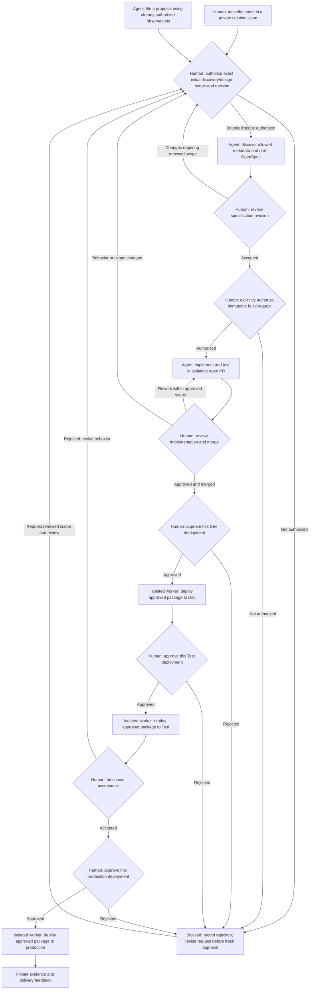

# Fabric-Delivery-OS

Specification-first, human-governed delivery for Microsoft Fabric.

The intended workflow takes a private solution issue through discovery,
specification, implementation, and staged delivery. Agents do bounded work;
humans decide what may be built, merged, and deployed.

## What exists today

**There is no complete runnable platform or released installer.** Cloning this
repository does not start agents, configure approvals, or provision resources.

The [OpenSpec task checklist](openspec/changes/establish-fabric-delivery-os/tasks.md)
separates completed bounded components from unfinished live integration and
labels work still in review. Its raw checkbox percentage is not an end-to-end
readiness score; only separately recorded human acceptance completes a release.

| Area | Actual status |
| --- | --- |
| Framework in this revision | One usable Python package: immutable manifests, local single-use authorization, local spend reservations, a [transactional local outbox](docs/durable-dispatch.md), read-only native approval evidence, cryptographic GitHub OIDC verification, and an [offline operator entry point](docs/offline-operator.md). Human review and installation acceptance remain separate requirements. |
| Authorization and identity boundary | Native/OIDC observations cannot become execution grants. Private request/input binding, actual App provenance, bypass policy, human credential provenance, and live installation proof are unresolved. The local authorization store accepts only externally verified bindings from a trusted adapter, not agent assertions. |
| Offline request/policy admission | A [dedicated local registry](docs/offline-request-registry.md) binds immutable policies, private issue revisions and manifests, retaining proposed/revoked/invalidated state. It authenticates no inputs/humans and cannot issue grants; live adapter/provenance integration remains missing. |
| Offline issue intake continuation | The [bounded GitHub capture adapter](docs/offline-github-intake.md) normalizes explicitly supplied private snapshots into proposed discover requests. It does not fetch issues or authorize discovery. [Teams intake contracts](openspec/changes/specify-offline-teams-intake/proposal.md) remain specification-only; no Teams connector is supplied. |
| Offline registry-bound coordination | A [separate four-file coordinator](docs/offline-registry-dispatch.md) joins proposal revalidation with existing grant consumption/reservation and rechecks before one claim. Its version-2 outbox rejects legacy access; proposal consistency is not human-approved issue provenance or live activation. |
| Offline role/skill selection | A [pure local resolver and runnable synthetic example](docs/offline-role-skills.md) support manually edited role policy/profile JSON, compatible supplied candidates, exact pins, visible quarantine and explicit LKG snapshots. It downloads/executes nothing; real role expertise, loaders and hosted agents remain unfinished. |
| Complete offline rehearsal | [`demo-delivery`](docs/offline-delivery-demo.md) exercises synthetic issue/skills/proposal/test-grant/one-claim/result plus durable drift refusal in fresh temporary stores. It is not live agent implementation, authenticated human approval or Fabric deployment. |
| Native GitHub gate proof | Separate public control smoke tests demonstrated human approval, human rejection, and refusal of a representative Actions-bot token. These are bounded gate tests, not production authorization or worker/cloud integration. |
| Azure runtime and onboarding | Not wired by this package. No released installer, complete cloud preflight, active worker, model call, or verified live Fabric integration is supplied. |
| First Fabric module | [SQL-to-Bronze compiler](docs/sql-bronze-module.md): explicit metadata to three stage-bound notebook payloads and a hashed release, with a fixed bounded create-only Spark worker. Compilation is usable offline; actual identity/deployment/load behavior is not live-verified. |

The [bot-refusal proof run](https://github.com/Remc0000/Fabric-Delivery-OS-Control/actions/runs/44172361707)
used workflow revision `3c8ab11dfb2660dd451d701e11458527c67bc868`.
The token could read the run but was not an eligible reviewer; its review attempt
returned HTTP 422 with no reviewable request. The native gate remained waiting,
with no runner or steps started and no review history. The run was cancelled
without approval, the workflow disabled, and the temporary environment removed.
This tests that Actions token only, not every future GitHub App identity. The
author's control repository is proof evidence, not a shared service for adopters.
The [control evidence/removal PR #7](https://github.com/Remc0000/Fabric-Delivery-OS-Control/pull/7)
records the scope and cleanup; it is not framework integration acceptance.

## Repository and execution boundaries

| Repository | Visibility | Responsibility |
| --- | --- | --- |
| Framework (this repository) | Public | Reusable Python primitives, offline checks, specifications and proposed runtime/module contracts; future versioned framework releases |
| Installation control (adopter-owned) | Public | Trusted native GitHub approval gates for that installation |
| Solution (adopter-owned) | Private | Issues, solution specifications, implementation, configuration, and detailed delivery evidence |

GitHub Free supports native required-reviewer gates in the public control
repository. **Protected jobs must run in that control repository itself.**
Calling a public reusable workflow from a private solution workflow does not
transfer the protection. Each adopter must verify reviewer eligibility,
trusted workflow/ref restrictions, and prevention of administrative bypass
before activation.

Public workflow definitions, run existence, timing, stage labels, and actor
information exposed by GitHub can be visible. Public control must receive only
opaque request references and allowlisted status, never private mappings,
manifests, code, prompts, records, model output, or raw logs. If that operational
metadata disclosure is unacceptable, this GitHub Free topology is incompatible;
do not activate it or weaken its gates.

In the planned architecture, autonomous model work runs on **private,
adopter-owned Azure compute using approved Foundry model deployments**, initially
with Python and Microsoft Agent Framework. The minimal trusted public dispatcher
is not where models or private code execute. Fixed, deterministic, isolated
deployment workers use separate environment identities; they do not let an agent
or arbitrary generated script wield deployment credentials. Azure hosting alone
does not guarantee that downstream tools/model routes meet a tenant or regional
data policy.

## Human and agent process

This is the **target lifecycle**, not an already wired end-to-end workflow.



- **Agents may propose issues, not authorize their execution.** A permitted
  proposal may use already authorized observations without build approval,
  only in allowed repositories/visibility, with sanitized public framework
  content and private solution details kept private. Filing grants no new
  source access, discovery, design, build or deployment authority. New
  agent-filed requests remain proposed/awaiting authorized human approval of
  the exact first substantive scope and frozen revision. Bounded discovery
  approval is not build/deployment permission. Author identity, assignment,
  labels, validation, another agent's review or mutable issue text cannot
  approve anything; changed scope requires renewed approval. The live automated
  issue adapter remains unsupported and disabled until this is enforced outside
  the model. The separate offline capture adapter accepts only supplied private
  snapshots and proposed requests; it is not that authenticated live boundary.
- **Specification review/merge is not build permission.** A human decision must
  explicitly authorize the corresponding build request; acceptance or structural
  validation alone cannot start implementation.
- **Implementation review/merge is another human decision.** Agents may propose
  changes and review findings, but never approve or merge their own work.
- **Dev, Test, and production each need independent explicit approval for every
  deployment attempt.** Functional acceptance is not production permission.
  Permitted data loads, scheduling, destructive operations, and recovery must be
  enumerated rather than implied by deployment approval.
- **Authority belongs outside the model.** Approval binds a private immutable
  manifest and exact input/artifact revisions, target baseline, policy, and
  execution profile. Grants are single-use; changed inputs, drift, revocation,
  or a retry require a new applicable request and approval.
- Humans hold configured approval/review/acceptance roles. A one-person pilot may
  combine roles only where policy permits, while recording each decision
  separately. Agents never administer their own protections, approve themselves,
  or receive human approval credentials.

## Setting up your own installation

Today you can prepare an installation and authorize bounded proofs; you cannot
install a complete runtime from this repository. There is no one-command setup,
complete installation configuration schema, or completed cloud
preflight/provisioning workflow. The offline tool below checks local inputs only.

### Prerequisites to decide and verify

- **GitHub:** your own account/organization and repository administration rights;
  an adopter-owned public control repository and private solution repository.
  Explicitly accept the public metadata disclosures above and verify native
  reviewer protections in the actual target control repository.
- **Azure and models:** an adopter-owned subscription, authorized bootstrap
  permissions, billing responsibility, approved Foundry model access and region,
  and explicit execution/cost limits. GitHub AI credits are not assumed to pay
  for direct Foundry calls.
- **Fabric:** tenant access and required administrator approvals; choose capacity
  and workspace mapping for each of Dev, Test, and production. Capacities may be
  shared if compatible and accessible; do not assume a trial or auto-selected
  capacity.
- **Tools and identities:** organization-approved packages, skill sources, and
  task-specific CLI/MCP tools; separate bootstrap, integration, agent, and
  environment deployment identities. Secrets belong in approved secret services,
  not repositories or public Actions logs.

### What you can do now

1. Read the [design](openspec/changes/establish-fabric-delivery-os/design.md)
   and contracts below. Review their assumptions and outstanding work; do not
   treat checklist completion or a specification merge as execution permission.
2. Choose your repository topology, human role assignments, allowed model inputs,
   modules, regions, capacities, and limits. Use your own repositories and
   identities, not the author's installation.
3. Keep installation mappings, source details, policy decisions, and proof
   evidence private; keep only intended reusable material and allowlisted
   control metadata public.
4. Have an authorized human explicitly approve a bounded bootstrap/proof plan
   before performing setup changes. Record its exact scope, revision, allowed
   effects, identities, and cleanup. Readiness or an authenticated session is not
   authorization.

### Manual GitHub App setup

These are preparation steps, **not an installer or permission to activate a
runtime**. Use adopter-owned accounts and repositories throughout. The intended
setup script must eventually collect installation-specific values, automate
supported operations and stop with explicit instructions at human-only steps.
That script and the protected credential uploader are not supplied yet.

1. In GitHub **Settings > Developer settings > GitHub Apps**, register two
   separate Apps. Organizations use their organization settings. Choose distinct
   solution-broker and control-dispatcher names; names are labels, not authority.
   The description's **Write / Preview** tabs are just a text editor.
2. Set **Homepage URL** to your framework/documentation repository URL; a separate
   website is unnecessary. Leave Redirect URI and Setup URL empty, wildcard
   matching off, **Request user authorization (OAuth) during installation** off,
   **Enable Device Flow** off and **Webhook > Active** off. No live webhook
   receiver is provided; leave Webhook URL and Secret empty.
   Keep **Only on this account** selected.
3. Expand **Repository permissions** and set the exact permissions below.
   Leave all other repository permissions, including **Workflows**, and all
   organization, account and enterprise permissions at **No access**.
   Inspect the actual fields: defaults or URL-prefilled forms can differ from
   the intended configuration.

| App | Repository permissions | Installation scope |
| --- | --- | --- |
| Solution broker | Contents, Issues, Pull requests: **Read and write**; Metadata: **Read-only** (automatic) | Only the intended private solution repository |
| Control dispatcher | Actions: **Read and write**; Contents and Metadata: **Read-only** | Only the intended public control repository |

4. Choose **Create GitHub App** and privately record each non-secret **App ID**.
   Registration is separate from installation. GitHub's registration UI can
   require a private key before installation; do not assume there is a key-free
   installation path.
5. **Pause before key-pair/private-key generation.** First establish the approved protected
   local-file/upload/storage path and verify redacted diagnostics with synthetic
   input. Never paste keys, client secrets or tokens into chat, Git, screenshots,
   command-line literals, plaintext parameter files or public Actions. A proposed
   upload path is not a shipped or verified uploader.
   If GitHub shows **Credentials > Client secrets / Key pairs**, choose
   **Key pairs** for the App private key. OAuth client secrets are not PEM
   keys and cannot be converted into them. Save the actual private-key
   download with a `.pem` filename; never manufacture a text-file substitute.
   Revoke any exposed secret through its owner controls without recording its
   value. Do not delete unrelated OAuth credentials.
6. Only after that path is ready, complete protected key enrollment and choose
   **Install App > Only select repositories**, selecting exactly the one
   repository for that App. **Only on this account** does not restrict which of
   that account's repositories can be selected. Never choose All repositories.
   Privately record installation IDs and verify actual numeric identities,
   effective permissions and selected repositories before use.
   Find an installation ID through **Settings > Applications > Installed
   GitHub Apps > Configure**: the plain URL ends in
   `/settings/installations/<installation-id>`. This is not the App ID;
   never share credential pages or OAuth callback/query parameters as evidence.
   A normal CLI login is not automatically an App-authorized API token.
   Report a rejected installation lookup without switching identities,
   broadening scopes or treating the owner's report as authenticated API proof.
   A separately reviewed owner-local verification flow may instead use the
   documented App-JWT endpoints with explicit local confirmation. It must bind
   the reviewed source/private registry and use only a temporary metadata-read
   token covering the installation's full existing selected scope, not a
   repository-narrowed token that hides extra access. Exact repository and
   permission checks, complete enumeration and confirmed token revocation are
   required before a safe receipt. Unknown issuance/cleanup must not retry or
   become success. Such a helper is currently a private pilot, not a released
   public installer; assistants never run its real-key step. No repeat Azure
   enrollment/canary or runtime activation follows from this metadata check.
   Once both safe receipts match the reviewed plan and confirm revocation,
   record completion privately and do not repeat the consumed attempt. Keep
   the original plan/registry inputs frozen and store any verified as-of
   snapshot separately. The snapshot is not a continuous scope guarantee or
   a grant to retrieve/enable credentials or activate a broker/runtime.

App permissions are not the agent sandbox: the solution App's write rights can
permit review/merge operations. A trusted broker must deny those operations,
keep App credentials/tokens away from agents, and limit control dispatch to the
reviewed workflow/ref. Registration, installation and a successful login do not
prove native human-gate enforcement or start any worker.

### Azure setup checkpoints

Before provisioning, inspect the selected subscription's required resource
providers and permissions. A missing provider registration is a separate
subscription-scoped prerequisite, not something an RG-only setup plan may
silently enable. Report the exact namespace and obtain the applicable approval;
do not grant broader rights to make setup pass.

For private Key Vault enrollment, Microsoft documents
[ARM-template secret creation as a control-plane operation](https://learn.microsoft.com/azure/key-vault/general/network-security#firewall-settings).
An approved operator-local helper can pass a protected file in memory as a
secure parameter without opening public vault access or enabling SSH. This is
the proposed ingress design, **not an implemented uploader**. Before real keys,
prove synthetic redaction across parameter/history/provider/error paths; keep
secrets out of outputs, names, tags and derived strings. Control-plane write
success does not prove private data-plane access or authorize credential retrieval.

Keep actual tenant/subscription IDs, repositories, App/installation IDs, endpoints,
capacity choices, secret references and raw evidence in private installation
configuration, never in the reusable public defaults. Reference and preserve
existing resources; do not recreate or relax them to make onboarding easier.

For Bicep-based setup, use **distinct explicit output filenames** for compiled
templates and parameters, such as `infra\main.template.json` and
`infra\main.parameters.json`. With matching source basenames, default output
names can collide and the parameter document can overwrite `main.json`.
Reject missing, swapped or colliding artifacts, changed private bindings and
any unexpected, duplicate, incomplete or non-create effect in an additive
preview. Compare existing ARM IDs case-insensitively; an Ignore/NoChange result
is a preview observation, not post-deployment preservation proof. Bind approval
to the reviewed immutable revision/blob, not platform-dependent CRLF worktree
bytes. These are implementation requirements, not additional shipped commands.

Show actual validation and security-review outcomes before requesting deployment.
If a required scanner is unavailable, state that it **did not run** and disclose
any policy-permitted manual-review exception; never claim an automated clean
scan or silently weaken an enforced protection. Human resource-list approval or
provider registration is not the later risk-acknowledged deployment decision.

### Reproducible setup contract

Every new setup operation must update its OpenSpec contract and this README in
the same change: prerequisites, exact automation or manual UI actions, identity
and permission scope, safe success evidence, failure/pause behavior and recovery
or cleanup. Future parameterized setup scripts must distinguish completed,
human-action-required, blocked and unknown states, resume only after verifying
actual state, and never turn a partial setup into a live-ready success.
Scripted provisioning still requires the applicable reviewed plan and human
authorization; scripts must not perform approvals for a human.

Protected enrollment must be an **operator-local** operation, not a way to
pass real key files through an agent. Reverify a fresh, unexpired synthetic
proof for the exact bindings/code/templates/runtime before key input; use a
separately authorized unique attempt ID for each probe. A private disabled
canary expires but does not automatically delete itself. Check actual App and
owner numeric identities, exact permissions and event subscriptions before
storage. Disabling a vault secret does **not** revoke its GitHub App key.

Use narrowly protected local storage outside Git and reject unsafe paths/ACLs;
per-user Windows ACLs do not isolate against administrators or same-user
processes. Preserve an exclusive pre-write checkpoint, report interrupted or
unverifiable writes as unknown, and recover through read-only verification
rather than automatic resubmission, rotation or journal deletion. Such local
checkpoints are not distributed locks or atomic cloud create-only guarantees.
Read-only recovery must preserve the original writer fingerprint: inspecting
an older attempt with corrected software does not prove a changed writer;
real-key input still requires a separately authorized matching-code probe.
On shared multi-account devices, select the approved cached subscription
identity without changing defaults and verify its authoritative tenant; never
use another identity to evade a denial. These remain public implementation
requirements, not a claim that an enrollment installer is supplied here.

### Use the bounded package locally

Python 3.11 or newer is required. Install from a reviewed checkout using your
organization's approved Python package source:

```powershell
python -m pip install ".[oidc]"
fabric-delivery validate-manifest "D:\PrivateInstallation\manifest.json"
fabric-delivery preflight --manifest "D:\PrivateInstallation\manifest.json" --spend-plan "D:\PrivateInstallation\offline-spend.json"
fabric-delivery self-test-dispatch
fabric-delivery demo-delivery
fabric-delivery compile-sql-bronze ".\examples\sql-bronze.synthetic.json" --output "D:\PrivateInstallation\synthetic-bronze-release"
```

These are placeholder local paths, not files included in this repository.
`python -m fabric_delivery_core` exposes the same commands. Manifest validation
returns 0 only for local schema/current-validity checks. **Preflight never exits
successfully as live readiness:** exit 3 means the requested offline checks
passed but live execution remains unsupported; exit 2 means invalid, missing, or
unknown offline inputs/dependencies. Both commands emit allowlisted JSON with
`execution_enabled: false`, without private identifiers, paths, or input values.
Manifest validation and preflight create no registry/ledger, contact no API, and
accept no credentials. `self-test-dispatch` exercises a real atomic local
grant/reservation/outbox cycle with synthetic fixtures in disposable storage
only. Its exit 0 means that inert exercise passed, not live readiness; it also
reports `execution_enabled: false` and accepts no existing installation files.
`compile-sql-bronze` writes a **new private** artifact directory from explicit
metadata, without contacting Fabric or reading source records. Exit 0 means
compiled-not-deployed, never permission to load data. Its checked-in example is
synthetic; real contracts and generated artifacts must remain private.
`demo-delivery` takes no inputs and joins supplied synthetic intake/skills to the
registry-bound local cycle, including pre-grant refusal and permanent skill/issue
drift. See [the runnable rehearsal and separate Dev pilot boundary](docs/offline-delivery-demo.md).

Read the [operator/schema guide](docs/offline-operator.md) and the component guides:
[authorization](docs/authorization-core.md),
[spend](docs/spend-guardrails.md),
[durable local dispatch](docs/durable-dispatch.md),
[native evidence](docs/native-approval-verifier.md), and
[OIDC](docs/github-oidc-verifier.md). The base authorization/spend package has no
runtime dependencies; optional `github` and `oidc` extras add maintained libraries.
No CLI command approves real work, uses an installation ledger, launches an
agent, contacts a model or deploys anything.

### What still needs implementation and verification

The [implementation checklist](openspec/changes/establish-fabric-delivery-os/tasks.md)
tracks the intended work, not an installer. Remaining integration includes
complete installation configuration/cloud preflight and approved provisioning.
The next trusted-adapter boundary is an authoritative private issue/request/policy
registry plus proven App separation, private input revalidation, and a
fail-closed join of native human-review and signed OIDC observations. Neither
observer currently issues grants; a signed GitHub token does not sign private
workflow inputs. Actual installation federation still needs a separately
authorized live-token proof.

The separately authorized [offline request/policy registry](docs/offline-request-registry.md)
now implements local immutable admission and permanent denial only. This is a
partial storage foundation, not the authenticated live registry or policy
administration. The separately authorized
[four-file coordinator](docs/offline-registry-dispatch.md) joins supplied proposal
consistency with already recorded grants locally; it does not authenticate the
private input a human approved or supply the native/OIDC/evidence-to-grant join.

The local outbox now commits grant consumption, maximum cost reservation and
ready work together, with one worker claim and conservative crash/unknown
handling. This does not supply a live dispatcher: trusted adapter/worker
integration, actual storage/recovery proof, ongoing cancellation and
target-conflict control remain required before external effects. The isolated Microsoft
Agent Framework/Foundry harness, mediated tools and trusted usage reporting,
independently approved stage deployment workers, and complete live ingestion,
Lakehouse, semantic-model and report delivery still need implementation.
The first bounded SQL-to-Bronze artifact compiler is now present; its create-only
behavior is not an implicit choice for any private solution. Real discovery,
identity/runtime acceptance, deployment/load integration, Silver/Gold logic and
semantic/report delivery remain outstanding.

These need separately authorized builds/bootstrap work and end-to-end negative
tests before activation. A local core or passing native gate does not close
those gaps. Only after integration is verified should an adopter request the
separate Dev, Test, acceptance, and production decisions in the lifecycle above.
Do not bypass a missing permission, licensing restriction, or unknown policy.

## Contract reference

Draft proposals live under `openspec/changes`. They remain unapproved until a
human explicitly reviews the applicable revision. OpenSpec validation checks
document structure; it does not prove security or authorize implementation.

The separate [Teams experience proposal](openspec/changes/add-teams-experience-layer/proposal.md)
adds optional conversational intake, private issue/PR feedback and navigation to
human review. GitHub remains the governance backbone; Teams does not authorize
execution. Standard GitHub app and Channel Agent/MCP support are verified
separately. This is specification-only: no Teams integration is implemented or
activated. See its [design and source verification](openspec/changes/add-teams-experience-layer/design.md),
[behavior contract](openspec/changes/add-teams-experience-layer/specs/teams-experience/spec.md)
and [separate review/build checklist](openspec/changes/add-teams-experience-layer/tasks.md).

- [GitHub lifecycle and revision-linked feedback](openspec/changes/establish-fabric-delivery-os/specs/github-lifecycle/spec.md)
- [Human authorization and single-use requests](openspec/changes/establish-fabric-delivery-os/specs/human-authorization/spec.md)
- [Onboarding and workspace choices](openspec/changes/establish-fabric-delivery-os/specs/onboarding/spec.md)
- [Independent distribution and reviewed upgrades](openspec/changes/establish-fabric-delivery-os/specs/distribution/spec.md)
- [Agent isolation and deterministic deployment](openspec/changes/establish-fabric-delivery-os/specs/agent-execution/spec.md)
- [Privacy and model-input boundaries](openspec/changes/establish-fabric-delivery-os/specs/information-boundaries/spec.md)
- [Approved skill sources and reproducible snapshots](openspec/changes/establish-fabric-delivery-os/specs/skills-and-tools/spec.md)
- [Finite execution spend and trusted accounting](openspec/changes/establish-fabric-delivery-os/specs/spend-guardrails/spec.md)

The proposed automatic skill refresh does not upgrade framework code, control
workflows, authorization policy, or permissions. Framework/control upgrades
remain separate, reviewed, pinned changes.
