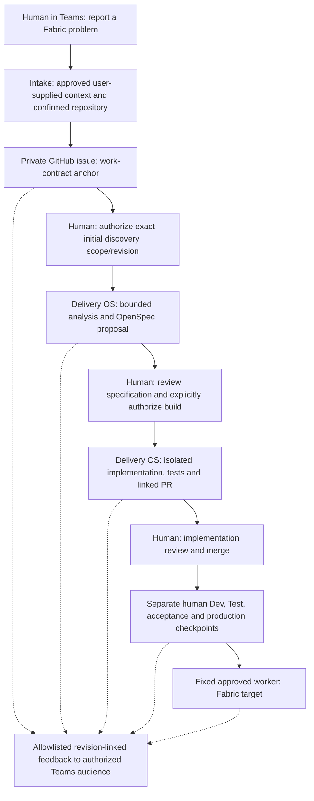

## Context

This is the proposed human-facing extension of
[`establish-fabric-delivery-os`](../establish-fabric-delivery-os/design.md),
not an implemented integration. The human authorized specification work only
on 2026-11-26. The private issue/request adapter and live approval/worker joins
already remain incomplete; Teams cannot bypass those dependencies.

## Goals / Non-Goals

**Goals:** conversational problem reporting, correct issue routing, GitHub-linked
delivery feedback, and understandable navigation to human decisions.

**Non-goals:** Teams-owned delivery state, agent approval, direct Teams-to-Fabric
effects, activation of GitHub cloud agents, or permission to deploy. No app,
subscription, OAuth configuration, or tenant setting is changed by this proposal.

## Decisions

### 1. GitHub remains the governance backbone

An issue/PR anchors the contract; mutable descriptions, comments, labels, or
Teams posts are not the immutable execution request. Private policy, manifests,
grants and detailed evidence retain their existing authoritative storage.
Feedback is a projection, never an independent approval ledger.

### 2. Support two separately verified intake routes

| Route | Candidate behavior | Activation boundary |
| --- | --- | --- |
| Standard GitHub Teams app | Create an issue from a message, edit the prefilled description/repository, add comments, close/reopen issues, and receive configured issue/PR notifications and link previews | Verify permissions, actual app behavior, routing and audience controls; do not assume broad built-in notifications are safe |
| Teams Channel Agent with GitHub MCP | Natural-language intake and approved GitHub reads; issue creation only if the selected connected app actually exposes an allowed write tool | Verify tenant availability, assigned license, channel membership, IT approval, OAuth scopes and exact tool support; unsupported writes remain blocked |

The standard app can prefill the last repository used in a channel and copy the
entire source message plus a Teams conversation link. Explicit destination and
content review are therefore required. If built-in issue creation, notifications
or previews cannot enforce the chosen classification/audience policy, that
surface is incompatible and stays disabled; use an approved private/manual
route, not a more permissive channel.

Current GitHub documentation also describes Copilot cloud-agent sessions in the
GitHub Teams app. That is a separate execution path, not the chosen private
Azure/Microsoft Agent Framework/Foundry delivery runtime. Its existence must not
silently turn intake into investigation or implementation. If it cannot be kept
outside the pilot path, block that route until a separately reviewed design.

### 3. Intake is not discovery authorization

The intake layer may clarify the user's already supplied intent (for example,
which pipeline the user means) under approved input policy. It cannot inspect
Fabric, query source records, read additional channel history, retrieve logs, or
start substantive analysis merely because an issue was created. Such work awaits
the exact applicable human scope approval and independent data-access policy.

All inbound text, links and attachments are untrusted. Source links are private
provenance only, not permission to read the conversation or expose its contents.
Record actual human initiator separately from an app/agent issue author.
Resolve repository identity and visibility from installation configuration.

### 4. Teams feedback reflects authoritative private state

An issue-created receipt is emitted only after verified creation; "analysis
started" only after the trusted adapter confirms authorized execution. Feedback
states include proposed/awaiting discovery approval, analysis running, awaiting
specification/build approval, PR awaiting review, validation result, stage
approval pending, accepted, delivered, rejected, blocked, failed, and unknown.
Do not keep an agent worker alive while a human decision is pending.

Private correlation binds installation, repository/issue identity, Teams
tenant/channel/thread, event identity, and current request/specification/artifact
revision. Duplicate intake delivery is reconciled before retry; ambiguous issue
creation cannot be replayed blindly. A failed Teams notification cannot roll back
GitHub state or replay a build/deployment. Out-of-order notifications cannot
overwrite a newer state; delivery failures are visible in private evidence.

Before each publication verify the destination's current authorized audience and
content classification, including guests/shared-channel members where applicable.
Repository access by one sender or OAuth identity is not access for the channel.
Generic status, a private deep link, or withholding may be required; private
identifiers, links, root causes and impact details are not inherently safe.
Unfurls and app-managed subscriptions require the same policy as custom cards.

### 5. Approval UX is navigation first, not new authority

The desired synthetic example is:

> Analysis completed for the approved revision. The Bronze schema changed while
> Silver still expects `customer_type`. Proposed fix: update the transformation
> and add schema validation. Impact: two files; no semantic-model change.
> Awaiting explicit build authorization.
>
> [Approve: review exact request] [Reject: review exact request] [View GitHub issue]

These are target UI labels and synthetic facts, not implemented buttons or a
guarantee that a standard GitHub card provides this flow. In the first supported
design both decision controls navigate to the trusted authenticated review
surface; the click, chat reply, reaction or agent-generated comment authorizes
nothing. Detailed summaries are shown only to a permitted audience.

A future custom decision bridge needs separately approved design/build and
proof of human identity/role, exact immutable revision/action, private durable
decision evidence, expiry/revocation, replay denial, changed-input denial, and
fail-closed integration. It cannot act using a human's GitHub credentials on
behalf of an agent or approve public native gates. Native protected jobs still
execute in public installation control with the human's direct eligible decision.
No generic "Approve fix" covers merge, Dev, Test, acceptance or production.

### 6. Optional, route-specific onboarding

Record approved Teams audience, route, app/tool versions, installation mappings,
human identities, OAuth scopes, data handling, notification allowlist, retention
and revocation policy privately. Verify the current license/SKU and tenant rollout
rather than treating a generic Copilot subscription claim as entitlement proof.
Channel Agent prerequisites must not be imposed on standard-app-only adopters.
No Teams capability is needed for GitHub-only delivery.

## Risks / Trade-offs

- Built-in apps may expose previews or notifications to a broader audience than
  GitHub permits. Test these actual surfaces or block their activation.
- Channel Agent processing is an additional model/data route. Approve its inputs,
  provider handling and tenant policy separately from the delivery runtime.
- OAuth authenticates access to GitHub, not authority to build/deploy or an
  Entra-to-GitHub human role mapping. Unverified mappings deny decision processing.
- Features, licenses and tools change. Record what was actually tested; do not
  infer production support from documentation or synthetic demo success.
- A custom approval bridge increases the trusted surface. Prefer deep links
  until its separate review and negative tests are complete.

## Verification and rollout

First review these specifications, then explicitly authorize a bounded integration
build. Start with synthetic user-supplied intake and private issue linkage.
Verify negative routing, duplicate/ambiguous writes, stale state, input injection,
audience drift, license/consent denial and missing discovery authorization.
Only after independently approved live proofs may feedback and decision navigation
be enabled. Separately gated Fabric deployments remain out of the intake proof.
No migration, installation or activation occurs in this specification update.

## Sources and open verification

Official documentation reviewed on 2026-11-26:

- [GitHub: creating issues in Teams](https://docs.github.com/en/integrations/tutorials/teams/create-issues):
  message actions, editable prefilled description, source link and last-used repository.
- [GitHub: managing issues in Teams](https://docs.github.com/en/integrations/tutorials/teams/manage-issues):
  comments, close/reopen, and signed-in permissions.
- [GitHub: using GitHub in Teams](https://docs.github.com/en/integrations/how-tos/teams/use-github-in-teams):
  subscriptions, previews, thread updates and the separate cloud-agent path.
- [GitHub: customizing notifications](https://docs.github.com/en/integrations/how-tos/teams/customize-notifications):
  event subscriptions are separate from agent-session repository settings.
- [Microsoft: Channel Agent with connected apps](https://support.microsoft.com/en-us/teams/chat-channels/use-channel-agent-with-jira-asana-and-github):
  GitHub MCP/read examples, OAuth consent, assigned Copilot subscription,
  channel membership, IT app approval and active connected accounts.

The reviewed Microsoft page does not establish GitHub issue creation through
Channel Agent, exact license/SKU eligibility, or a Delivery OS approval card.
Those remain explicit capability/proof questions, not accepted product facts.
